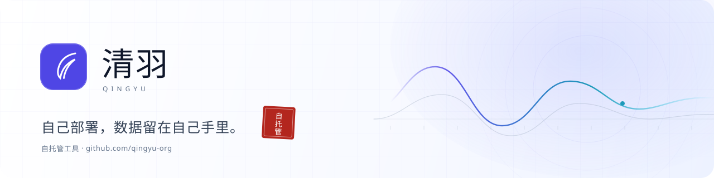

<picture>
  <source media="(prefers-color-scheme: dark)" srcset="banner-dark.svg">
  
</picture>

# 清羽 · QingYu

**有用，优雅，且可以自己拥有。**

一个自托管的开源软件品牌，由 LiuShen 发起。

[项目展示页](https://qingyu-org.github.io/.github/) · [GitHub](https://github.com/qingyu-org) · [组织说明](https://github.com/qingyu-org/.github)

## 作品

| 项目 | 它是什么 | 在线使用 |
| :--- | :--- | :--- |
| **[清羽盘搜](https://github.com/qingyu-org/Pansou)** · Pansou | 可以自己运营的网盘搜索站。搜索聚合、配额、审计与上游同步，都在同一个仓库里。 | [so.liushen.fun](https://so.liushen.fun) |
| **[清羽相册](https://github.com/qingyu-org/Album)** · Memora | 把照片放回自己的硬盘：瀑布流、相册与地图，都由你部署。 | [xc.liushen.fun](https://xc.liushen.fun) |
| **[清羽评论](https://github.com/qingyu-org/Commits)** · Commits | Artalk 的自维护分支，为博客准备一套跟得上自己节奏的评论系统。 | [源码](https://github.com/qingyu-org/Commits) |
| **[清羽片段](https://github.com/qingyu-org/Gist)** · Gist | 每个片段都是一个 Git 仓库。浏览器里随手写，也可以 clone 下来继续改。 | [gist.liushen.fun](https://gist.liushen.fun) |
| **清羽通行证** · Auth | 单站点部署的 OAuth 2.0 / OIDC 单点登录，账户、设备与权限收在一处。 | [auth.liushen.fun](https://auth.liushen.fun) |

## 做法

**自托管。** 默认把数据和服务放在自己的机器上。部署是一份能力，不是一份许可。

**克制。** 只做日常真正会用到的部分，把剩下的空间留给内容与呼吸。

**可离开。** 格式开放，导出完整。喜欢就留下，不喜欢可以随时带走。

---

QingYu（清羽 / 清羽飞扬）· 各项目遵循其仓库内的许可证。
